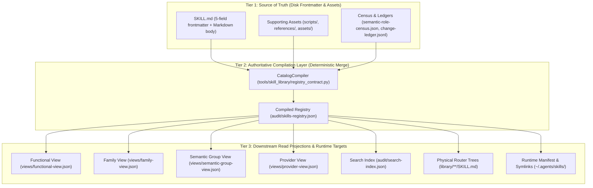

# Architecture Resolution: Rich Governance Metadata vs. Five-Field Runtime Frontmatter

## 1. Problem Statement & Architectural Tension

The `REVREBEL/skills-library` ecosystem operates under two conflicting operational demands:

1. **Lightweight Runtime Consumption**:
   Agent runtimes (Claude Code, Gemini CLI, Cursor, Antigravity, and OpenAI custom tools) load skill definition files directly into their Large Language Model (LLM) context windows. Bloated YAML frontmatter headers containing dozens of internal governance fields (UUIDs, multi-hop relationship matrices, provenance commit hashes, AST symbol linkages, validation status flags) consume precious context tokens and confuse prompt instruction parsers. Runtimes require a compact, highly standardized, 5-field schema.

2. **Rigorous Enterprise Governance & Architecture (ADR-000 through ADR-005)**:
   Enterprise skill management across 5,000+ files requires rich multi-dimensional metadata: 4 decoupled architectural axes (Identity, Semantic Ownership, Physical Location, Family Membership), 10 first-class object roles, 8 relationship edge types, multi-provider bindings (CLI, MCP, API, SDK, Native), cryptographic SHA-256 package manifests, and migration gate compliance ledgers.

### Resolution Summary
This tension is resolved by establishing an **immutable unidirectional authority hierarchy** that separates the **source-of-truth capability payload** from the **authoritative compilation layer** and **downstream projection views**. Governance metadata is **compiled out-of-band** into `audit/skills-registry.json` and projection views, leaving the on-disk `SKILL.md` strictly focused on capability execution.

---

## 2. The Three-Tier Architectural Hierarchy



### Tier 1: Source Frontmatter (`SKILL.md`) — The Execution Contract
- **Authority**: Primary source of capability instructions.
- **Physical Representation**: Top-of-file YAML frontmatter delimited by `---` blocks in `SKILL.md`.
- **Field Limit**: Exactly 5 standard runtime-compatible fields.
- **Role**: Instructs the agent runtime *what* the skill does, *when* to trigger it, and basic provenance/risk boundaries.

### Tier 2: Compiled Catalog Registry (`audit/skills-registry.json`) — The Authoritative Governance Layer
- **Authority**: Single source of truth for full architecture state.
- **Physical Representation**: Deterministic JSON generated by `CatalogCompiler`.
- **Role**: Combines Tier 1 frontmatter with census data, family qualifications, duplicate registries, and change ledgers. Contains the full 4 axes, 10 roles, 8 relationships, and cryptographic file manifests.

### Tier 3: Generated Projection Views & Runtime Targets — The Read Surfaces
- **Authority**: Downstream, read-only projections. Pure functions of Tier 2 (`f(Registry) -> View`).
- **Physical Representation**: Static JSON views in `views/`, search indexes in `audit/`, physical Markdown router files, and materialized symlinks in `~/.agents/skills/`.
- **Role**: Serve specialized discovery, agent routing, and execution dispatch queries without scanning raw files.

---

## 3. Schema Comparison & Field Mapping

| Dimension | Tier 1: Runtime Frontmatter (`SKILL.md`) | Tier 2: Compiled Registry (`skills-registry.json`) |
| :--- | :--- | :--- |
| **Storage Location** | `library/<domain>/<subdomain>/<leaf>/SKILL.md` | `audit/skills-registry.json` |
| **Field Count** | Exactly 5 standard fields | 20+ comprehensive governance fields |
| **Format** | YAML frontmatter block | JSON dictionary / `RegistryEntry` dataclass |
| **Consumer** | Agent Runtimes (Claude, Gemini, Cursor) | Build tools, CI gates, migration runners, auditors |
| **Token Impact** | Minimal (~40-60 tokens per skill) | Zero LLM token footprint during execution |
| **Mutability** | Editable during skill authoring | Generated deterministically via `CatalogCompiler` |

### Detailed Field Specification: The Five-Field Frontmatter

Every canonical `SKILL.md` in the library conforms to this standard 5-field schema:

```yaml
---
name: backend-api-design
description: Design, implement, and document REST and GraphQL APIs. Use when designing API schemas, endpoints, error contracts, or reviewing backend interfaces.
source: community_canonical
risk: low
license: MIT
---
```

1. **`name`** (`string`, Required):
   - Canonical leaf slug matching directory basename `^[a-z0-9][a-z0-9_.-]*[a-z0-9]$`.
   - Used for command invocation and local indexing.

2. **`description`** (`string`, Required):
   - Human-readable summary of capability followed by explicit trigger contract clause (`Use when ...`).
   - Validated against `TRIGGER_CONTRACT_PATTERN` (`tools/skill_library/config.py`).

3. **`source`** (`string`, Required):
   - High-level provenance marker (e.g. `community_canonical`, `intake`, `custom`, `platform_hub`).
   - Prevents unverified ingestion from untrusted upstream sources.

4. **`risk`** (`string`, Required):
   - Safety classification (`unknown`, `low`, `elevated`, `critical`).
   - Informs agent runtime execution policies and sandboxing.

5. **`license`** (`string`, Required):
   - Legal license identifier (e.g. `MIT`, `Apache-2.0`, `not_declared_upstream`).
   - Enforces open-source compliance boundaries.

---

### Detailed Field Specification: The Rich Governance Schema (`RegistryEntry`)

The compiled registry inflates each skill into a rich architectural record:

```json
{
  "canonical_id": "api:backend-api-design",
  "urn": "urn:skill:api:backend-api-design",
  "name": "backend-api-design",
  "role": "CAPABILITY",
  "status": "ACTIVE",
  "domain": "development",
  "category": "development",
  "subcategory": "backend",
  "physical_path": "development/backend/backend-api-design",
  "families": ["api-design", "backend-core"],
  "belongs_to_family": true,
  "description": "Design, implement, and document REST and GraphQL APIs. Use when designing API schemas, endpoints, error contracts, or reviewing backend interfaces.",
  "source": "community_canonical",
  "risk": "low",
  "license": "MIT",
  "relationships": {
    "composed_of": [],
    "extends": [],
    "depends_on": ["shared:http-spec"],
    "adapts": [],
    "aliased_to": []
  },
  "execution_providers": [
    {
      "provider_type": "CLI",
      "binary_name": "curl",
      "transport": "stdio"
    }
  ],
  "provenance": {
    "source_hash": "a1b2c3d4...",
    "content_hash": "e5f6g7h8...",
    "commit_sha": "195eda775d7a8dcad1837a1990bcba8259da3ea0",
    "census_confidence": "high"
  },
  "tags": ["api", "rest", "graphql", "backend"]
}
```

---

## 4. Compilation & Synchronization Rules

1. **Unidirectional Compilation**:
   - `Source Frontmatter + Census Metadata -> CatalogCompiler -> Compiled Registry -> Projection Views`.
   - Never backport compiled governance fields (e.g. `urn`, `relationships`, `commit_sha`) into raw `SKILL.md` frontmatter.

2. **Trigger Contract Preservation**:
   - The frontmatter `description` field is parsed by `tools/skill_library/validator.py` to ensure it contains a valid trigger contract. The compiler extracts keywords and semantic terms from the description to build `audit/search-index.json`.

3. **Deterministic Hash Equality (INV-8 & Gate 7)**:
   - Successive runs of `CatalogCompiler.compile()` on identical repository trees must produce cryptographically byte-equal outputs in `audit/skills-registry.json` and all `views/*.json`.

4. **Name Synchronization**:
   - The frontmatter `name` must exactly match the containing directory leaf slug. Any mismatch between `fm['name']` and `os.path.basename(skill_dir)` fails Gate 1 validation.
