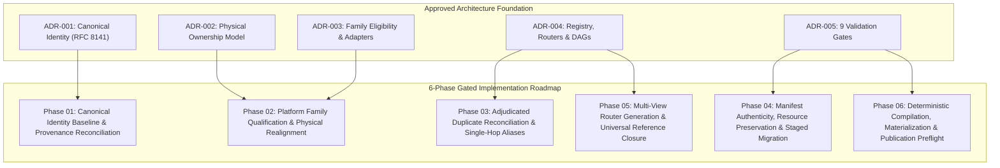
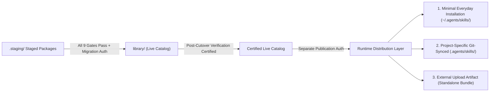

# Skills Library Implementation Roadmap & Migration Plan

- **Status**: Approved & Authoritative (REV-132 Accepted)
- **Date**: 2026-10-18
- **Work Order**: REV-132 (`9d8480d2-d995-44e0-b185-e869770d7346`)
- **Supersedes**: Legacy Rebuild Tasks (Phases 01–13) & Held Duplicate Plan (REV-125)
- **Preceding Architectural Decisions**:
  - [REV-126 / REV-150: Semantic Role Census](../../audit/taxonomy-census/semantic-role-census.json)
  - [ADR-001: Path-Independent Canonical Identity Contract](decisions/ADR-001-path-independent-canonical-identity.md) (REV-127)
  - [ADR-002: Physical Ownership Model](decisions/ADR-002-physical-ownership-model.md) (REV-128)
  - [ADR-003: Platform Family Eligibility & Provider-Adapter Implementation Rules](decisions/ADR-003-family-eligibility-and-provider-adapters.md) (REV-129)
  - [ADR-004: Registry, Router, Alias, Dependency, and Semantic Group Contracts](decisions/ADR-004-registry-router-alias-dependency-contracts.md) (REV-130)
  - [ADR-005: Architecture Validation and Migration Gates](decisions/ADR-005-architecture-validation-and-migration-gates.md) (REV-131)

---

## 1. Executive Summary & Objective

Under **REV-126 through REV-131**, the skills library established a comprehensive semantic object model, hybrid physical layout, platform family qualification framework, dependency DAG invariants, multi-view router architecture, and formal validation gates.

The objective of **REV-132** is to replace the pre-architectural restructuring tasks (historical Phases 01–13) and the suspended duplicate-cleanup plan ([REV-125](https://linear.app/revrebel/issue/REV-125/hold-bulk-duplicate-reconciliation-until-taxonomy-architecture-is-approved)) with an **authoritative, gate-governed migration roadmap**.

This roadmap provides:
1. **Full Traceability to Historical Evidence**: All 2,103 historical Phase 01–12 records in `audit/rebuild-phase-1-12/` are mapped to modern canonical identities without rewriting historical audit trails.
2. **Replacement of Naive Duplicate Cleanup**: The held 470-group / 488-loser duplicate plan is superseded by semantic, gate-governed duplicate adjudication (Gate 3), preserving the 15 unresolved GitHub duplicate pairs in direction-neutral status.
3. **6 Sequential, Gated Migration Phases**: Every physical and logical operation is tied to the 9 formal validation gates established in ADR-005 (with Gate 7 evaluated as a baseline compilation check in Phase 01 and verified as a final idempotency check in Phase 06).
4. **Strictly Non-Destructive Preflight Execution**: Physical relocations require cryptographic SHA-256 manifest authenticity, authorized staging directories, and path-containment verification before any live catalog file may be touched.



---

## 2. Invariants Catalog (Roadmap Compliance)

All migration phases strictly enforce the 10 architectural invariants codified in ADR-001 through ADR-005:

| Invariant | Name | Formal Contract |
| :--- | :--- | :--- |
| **INV-1** | **Strict DAG Acyclicity** | Relationship graph $G=(V, E)$ over `depends_on`, `composed_of`, `extends`, `adapts` has no directed cycles: $\forall v \in V, v \notin \text{Reachable}^+(v)$. |
| **INV-2** | **Single Canonical Owner** | Every skill package has exactly one canonical identity $u \in \text{URN}$ (`urn:skill:<scope>:<slug>`). No two active packages share an identity. |
| **INV-3** | **Single-Hop Alias Purity** | Every alias points directly to an active canonical capability or workflow. No alias chaining ($a_1 \to a_2 \to t$) or self-loops ($a \to a$). |
| **INV-4** | **Shallow Overlay Specialization** | Overlays only specialize base capabilities or workflows. Overlays cannot extend overlays ($\text{depth}(o) \le 1$). |
| **INV-5** | **Leaf Primitive Purity** | Primitives are reusable atomic units and cannot compose other objects ($\text{composed\_of}(p) = \emptyset$). |
| **INV-6** | **Path Independence** | Canonical keys `<scope>:<slug>` match `^[a-z0-9-]+:[a-z0-9-]+$` with zero filesystem path characters (`/`, `\`, `.`), represented as RFC 8141 URNs `urn:skill:<scope>:<slug>`. |
| **INV-7** | **Universal Reference Closure** | For every reference edge $e = (u, v) \in E$, the target $v$ exists in authoritative catalog registry $V$. No dangling edges. |
| **INV-8** | **Family Boundary Separation** | Tier 1 platform hubs require census-backed 4-gate qualification. Tier 2 families are virtual routers in domain trees. Unadjudicated duplicates remain direction-neutral. |
| **INV-9** | **Transitive Materialization Completeness** | Any materialized project bundle $\mathcal{B}(S)$ must contain all transitive prerequisites: $\forall s \in \mathcal{B}(S), \text{Dependencies}(s) \subseteq \mathcal{B}(S)$. |
| **INV-10** | **Deterministic Compilation Idempotency** | Two separate compilations over identical inputs produce bit-for-bit identical outputs: $\text{SHA-256}(C_1) \equiv \text{SHA-256}(C_2)$. |

---

## 3. Preservation of Historical Rebuild Evidence & Replacement of Naive Duplicate Cleanup

### 3.1 Immutable Historical Provenance
The historical Phase 01–12 rebuild artifacts are permanently preserved as immutable audit evidence:
- **`audit/rebuild-phase-1-12/`**: Contains the complete historical dataset:
  - `phase08-canonical-registry.csv` (2,103 historical records)
  - `phase08-batch-plan.csv` (162 batch migration allocations)
  - `split-allocations.csv` and `split-decisions.csv` (Phase 07 split tracking)
  - `merge-decisions.csv` and `merge-members.csv` (Phase 06 merge tracking)
  - `phase09-resource-registry.csv` and `phase10-functional-routing-map.csv`
  - Historical verification scripts (`verify_phase_*.py`)
- **`library-rebuild-tasks/legacy-rebuild-phase-1-13/`**: Contains the 16 legacy task specifications (`01-establish-baseline.md` through `13-...md`), safely archived with an explicit provenance notice.
- **`library-rebuild-tasks/artifacts/`**: Contains historical scripts and batch logs.

### 3.2 Superseding the Naive Duplicate-Cleanup Plan (REV-125)
In the legacy Phase 06 rebuild effort, a heuristic 470-group / 488-loser duplicate reconciliation plan was proposed. That plan was frozen under **REV-125** because:
- It relied on mechanical path-depth winner rules (`prefer shallower directory depth`), which selected wrong canonical owners for platform families (such as NotebookLM, Figma, and GitHub).
- It proposed bulk deletion of loser directories without single-hop alias redirects or tombstone tracking.
- It conflated distinct capabilities that shared similar leaf names across different domains.

**Roadmap Resolution**:
The legacy duplicate deletion plan is replaced by **Phase 03 (Adjudicated Duplicate Reconciliation & Single-Hop Alias Contracts)**:
1. Every candidate pair is evaluated using the semantic role census (`audit/taxonomy-census/semantic-role-census.json`) and explicit semantic role review.
2. The **15 unresolved GitHub candidate pairs** are held strictly direction-neutral until explicit adjudication.
3. Consolidations are represented non-destructively through single-hop aliases (`points_to`, `alias_type: TOMBSTONE | DEPRECATED | SHORTCUT`) conforming to Gate 3, preserving backward compatibility and historical reference integrity.

---

## 4. The 6-Phase Implementation Roadmap

The implementation roadmap divides all remaining migration and publication work into 6 sequential, gate-verified phases:

```mermaid
sequenceDiagram
    autonumber
    participant Dev as Engineering / Agent
    participant Runner as MigrationGateRunner
    participant Staging as Staging Root (.staging/)
    participant Live as library/ (Live Catalog)
    participant Runtime as ~/.agents/skills/

    Note over Dev,Runner: Phase 01: Canonical Identity & Provenance
    Dev->>Runner: Evaluate Gate 1 & Reconcile Historical CSVs
    Runner-->>Dev: Gate 1 Passed (100% Provenance Reconciled)

    Note over Dev,Runner: Phase 02: Family Qualification & Physical Boundaries
    Dev->>Runner: Evaluate Gate 2 via FamilyCandidateEvaluator
    Runner-->>Dev: Gate 2 Passed (Tier 1 vs Tier 2 vs Direction-Neutral Held)

    Note over Dev,Runner: Phase 03: Duplicate Adjudication & Aliases
    Dev->>Runner: Evaluate Gate 3 (Graph Topology & Single-Hop Aliases)
    Runner-->>Dev: Gate 3 Passed (Zero Cycles, Zero Alias Chaining)

    Note over Dev,Staging: Phase 04: Manifest Authenticity & Staged Verification (Zero Live Mutation)
    Dev->>Staging: Prepare manifests & stage candidate packages
    Dev->>Runner: Evaluate Gate 4 (Three-Tier Manifest & SHA-256 Authenticity)
    Runner-->>Dev: Gate 4 Passed (Authenticity & Path Containment Verified; Live Untouched)

    Note over Dev,Runner: Phase 05: Multi-View Routers & Reference Closure (Target State)
    Dev->>Runner: Validate 4 Views, Routers & Closure against Proposed Target State
    Runner-->>Dev: Gate 5 & 6 Passed (100% Target Reference Closure)

    Note over Dev,Runner: Phase 06: Deterministic Compilation, Materialization & All 9 Gates
    Dev->>Runner: Evaluate Gate 7, 8, 9 & Run Full 9-Gate Catalog Suite
    Runner-->>Dev: All 9 Gates Passed (Preflight Certified, Rollback Journals Prepared)

    Note over Dev,Live: Post-Gate Cutover & Verification (Explicit Migration Authorization Required)
    Dev->>Dev: Require explicit migration authorization (live cutover approval)
    Dev->>Live: Execute atomic live cutover from Staging
    Dev->>Runner: Verify resulting live catalog across all gates
    Runner-->>Dev: Live catalog verified; retain rollback capability

    Note over Dev,Runtime: Optional Post-Validation Runtime Distribution (Separate Publication Authorization Required)
    Dev->>Dev: Require separate publication authorization
    Dev->>Runtime: Distribute to destination runtimes via deterministic package builder & adapters
```

---

### Phase 01: Canonical Identity Baseline & Historical Provenance Reconciliation
- **Objective**: Establish immutable canonical identities for all 2,133 active skill packages and reconcile 100% of historical Phase 01–12 rebuild records without modifying live catalog files.
- **Enforced Gates**: **Gate 1** (Canonical Identity & Structure) and **Gate 7** (Deterministic Baseline Compilation).
- **Key Work**:
  1. Parse all active skills from `library/**` and assign canonical IDs matching regex `^[a-z0-9-]+:[a-z0-9-]+$`.
  2. Parse `audit/rebuild-phase-1-12/phase08-canonical-registry.csv` (2,103 records), `phase08-batch-plan.csv` (162 batches), and `split-allocations.csv`.
  3. Reconcile historical paths (`task-folder/agents/skills-rebuild/...`) to modern paths (`library/...`). Reconcile known alias outlier (`design-md_v1` $\to$ `design-md`).
  4. Track the 30 platform additions evaluated in REV-126/150 as `PLATFORM_CENSUS_ADDITION`.
  5. Generate `audit/provenance-reconciliation-report.json` certifying 100% reconciliation.
- **Completion Gate**: Gate 1 reports `PASSED`; `ProvenanceReconciliationReport.is_fully_reconciled == True`; zero live catalog files modified.
- **Specification**: [`library-rebuild-tasks/phase-01-canonical-identity-provenance-baseline.md`](../../library-rebuild-tasks/phase-01-canonical-identity-provenance-baseline.md)

---

### Phase 02: Platform Family Qualification & Physical Directory Realignment
- **Objective**: Apply the census-backed 4-Gate Family Qualification Framework to establish Tier 1 physical platform hubs while strictly confining Tier 2 families and pending candidates to virtual domain routing.
- **Enforced Gates**: **Gate 2** (Family Placement & Tier Qualification).
- **Key Work**:
  1. Execute independent census cross-examination via `FamilyCandidateEvaluator.evaluate_from_ledger()` against `audit/taxonomy-census/semantic-role-census.json`.
  2. Authorize Tier 1 physical hubs under `library/tools-and-platforms/<family-slug>/` only for qualified platform families (`github`, `webflow`, `figma`).
  3. Restrict Tier 2 logical families (`supabase`, `browser-automation`) to virtual routers in functional domain trees (`library/development/backend/`, `library/workflow-and-automation/`).
  4. Hold `notebooklm` in `PENDING_ADJUDICATION` virtual domain routing (`library/data-and-ai/`).
  5. Decouple execution providers into pure protocol adapters (`adapts: provider:<name>`), running cycle detection across adapter edges.
- **Completion Gate**: Gate 2 reports `PASSED`; unqualified families prevented from creating physical hubs; adapter cycles: 0.
- **Specification**: [`library-rebuild-tasks/phase-02-family-qualification-physical-layout.md`](../../library-rebuild-tasks/phase-02-family-qualification-physical-layout.md)

---

### Phase 03: Adjudicated Duplicate Reconciliation & Single-Hop Alias Contracts
- **Objective**: Replace the held REV-125 duplicate-cleanup plan by adjudicating duplicates into single-hop alias pointers while holding candidate pairs direction-neutral until formal review.
- **Enforced Gates**: **Gate 3** (Graph Topology, Acyclicity & Alias Purity).
- **Key Work**:
  1. Hold all 15 unresolved GitHub duplicate pairs in `DuplicateCandidateRegistry.CANDIDATE_HYPOTHESES` strictly direction-neutral.
  2. For candidate pairs undergoing approved adjudication, select the canonical winner based on semantic role census evidence.
  3. Create single-hop alias pointers (`points_to`, `alias_type: TOMBSTONE | DEPRECATED | SHORTCUT`) pointing directly to canonical targets.
  4. Validate DAG acyclicity over `depends_on`, `composed_of`, `extends`, and `adapts`.
  5. Enforce leaf primitive purity ($\text{composed\_of} = \emptyset$) and shallow overlay depth ($\text{depth} \le 1$).
- **Completion Gate**: Gate 3 reports `PASSED`; alias chains: 0; alias self-loops: 0; graph cycles: 0; unadjudicated aliases: 0.
- **Specification**: [`library-rebuild-tasks/phase-03-duplicate-adjudication-alias-contracts.md`](../../library-rebuild-tasks/phase-03-duplicate-adjudication-alias-contracts.md)

---

### Phase 04: Manifest Authenticity, Resource Preservation & Staged Verification
- **Objective**: Prepare manifests, stage candidate packages in authorized staging directories, and verify file authenticity and path containment without modifying the live library.
- **Enforced Gates**: **Gate 4** (Resource & Asset Preservation, Zero Data Loss).
- **Key Work**:
  1. Authorize physical moves exclusively through complete, matching source and destination `SkillPackageManifest` records.
  2. Stage candidate destination packages in an authorized staging directory (`staged_dir` within approved `staging_root`).
  3. Perform Three-Tier Manifest Evidence Verification (Gate 4):
     - Tier 1: Manifest presence and path alignment.
     - Tier 2: Fresh on-disk recursive SHA-256 inventory generation and cross-examination (rejecting fabricated or stale manifests).
     - Tier 3: Source-to-destination 1-to-1 checksum comparison ($\text{SHA-256}_{\text{source}} \equiv \text{SHA-256}_{\text{staged\_dest}}$).
  4. Enforce canonical path containment: reject path traversal (`..`), symlinks outside boundaries, or caller self-authorizing staging roots.
  5. Strictly preserve live catalog files: zero modifications, moves, or deletions in `library/**` during Phase 04. Physical cutover is deferred until all 9 validation gates pass and explicit batch approval is granted.
- **Completion Gate**: Gate 4 reports `PASSED`; 100% of files and checksums accounted for; zero truncated assets; zero modifications to the live library.
- **Specification**: [`library-rebuild-tasks/phase-04-manifest-authenticity-staged-migration.md`](../../library-rebuild-tasks/phase-04-manifest-authenticity-staged-migration.md)

---

### Phase 05: Multi-View Router Generation & Universal Reference Closure (Target State)
- **Objective**: Deterministically validate all four ADR-004 discovery projection views, generated router hierarchies, dependencies, and inverted token search indexes while guaranteeing universal reference closure against the proposed target state. Treat overlays and cross-cutting workflow packs as additional semantic projections and content structures.
- **Enforced Gates**: **Gate 5** (Reference Closure & Dependencies) and **Gate 6** (Generated-View Reconciliation & Router Integrity).
- **Key Work**:
  1. Verify universal reference closure against proposed target state: every identifier in `depends_on`, `composed_of`, `extends`, `adapts`, and `aliased_to` resolves to an active catalog entry ($u \to \emptyset$ is fatal).
  2. Compile and validate all **4 canonical ADR-004 projection views** against proposed target state via `MultiViewProjector`:
     - **View 1: Functional / Domain View** (`views/functional-view.json` and domain router `SKILL.md` hierarchy under `library/<category>/<subcategory>/`)
     - **View 2: Platform / Family View** (`views/family-view.json`, Tier 1 hub routers `library/tools-and-platforms/<family-slug>/SKILL.md`, and Tier 2 virtual routers `views/routers/family-<family-slug>.md`)
     - **View 3: Semantic Group View** (`views/semantic-group-view.json` for cross-cutting task clusters like `git-automation`, `fullstack-auth`, `database-migrations`)
     - **View 4: Execution / Provider View** (`views/provider-view.json` indexing runtime transport protocols: `cli`, `mcp`, `rest_api`, `sdk`, `prompt_template`)
  3. Validate additional semantic projections and content structures against proposed target state:
     - Capability overlays specializing base capabilities (`extends`)
     - Cross-cutting composite workflow packs (`composed_of`)
  4. Generate and validate search index (`audit/search-index.json`).
  5. Enforce 100% relative link purity in markdown routers against proposed target state (rejecting absolute filesystem paths and `file:///` URLs).
  6. Display execution provider badges (`CLI`, `MCP`, `REST`, `SDK`, `Prompt`) on platform family routers.
- **Completion Gate**: Gates 5 and 6 report `PASSED`; dangling references: 0; forbidden absolute links: 0; catalog coverage: 100% against proposed target state.
- **Specification**: [`library-rebuild-tasks/phase-05-multi-view-routers-reference-closure.md`](../../library-rebuild-tasks/phase-05-multi-view-routers-reference-closure.md)

---

### Phase 06: Deterministic Compilation, Project Materialization & Full Gate Evaluation
- **Objective**: Complete deterministic compilation, project materialization validation, publication preflight simulation, and full 9-gate catalog evaluation before any live cutover. Decouple downstream runtime distribution as an independent, optional post-validation operation.
- **Enforced Gates**: **Gate 7** (Deterministic Compilation Idempotency), **Gate 8** (Project Materialization & Collision-Free Naming Ladder), and **Gate 9** (Runtime Publication Pre-Flight).
- **Key Work**:
  1. Compile `audit/skills-registry.json` and verify bit-for-bit reproducibility across consecutive compilations with pinned timestamps:
     $$\text{SHA-256}(\text{Compilation}_1) \equiv \text{SHA-256}(\text{Compilation}_2)$$
  2. Test standalone project bundle materialization ($\mathcal{B}(S)$), proving transitive dependency closure ($\bigcup \text{Closure}(s)$) and zero missing prerequisites.
  3. Verify the collision-free runtime naming ladder implemented in `ProjectMaterializer._generate_flat_runtime_names()` (ADR-004 Section 9.2):
     $$\text{Natural Name} \longrightarrow \text{Category Prefix} \longrightarrow \text{Canonical Scope} \longrightarrow \text{Scope + Category} \longrightarrow \text{Canonical Slug} \longrightarrow \text{Disambiguated Slug}$$
     proving $|Names| = |Skills|$ with zero collisions across materialized project bundles.
  4. Perform non-destructive publication preflight simulation (Gate 9), ensuring protected catalog paths (`library/**`, `audit/taxonomy-census/**`) remain completely clean and unmutated.
  5. Execute full 9-gate catalog evaluation via `MigrationGateRunner.run_all_gates()` verifying all 9 gates return `PASSED` (`report.all_passed == True`).
  6. Prepare forward execution journal ($\mathcal{J}_{\text{forward}}$) and reverse rollback journal ($\mathcal{J}_{\text{rollback}}$).
  7. Define runtime distribution as a separate, optional, post-validation operation supporting three distinct destination types (minimal everyday installation, project-specific Git-synced installation, and external upload artifact) orchestrated by the upcoming deterministic package builder and runtime adapters under separate publication authorization.
- **Completion Gate**: Gates 7, 8, and 9 report `PASSED`; all 9 validation gates return `PASSED`; `MigrationGateReport.all_passed == True`; preflight certified for post-gate cutover.
- **Specification**: [`library-rebuild-tasks/phase-06-compilation-materialization-publication-preflight.md`](../../library-rebuild-tasks/phase-06-compilation-materialization-publication-preflight.md)

---

## 5. Gate Evaluation Matrix

The following matrix maps each of the 9 formal migration gates to its primary phase, enforced invariants, evaluation engine method, and failure diagnostics:

| Gate | ID | Phase | Invariants | Evaluation Engine Method | Fatal Violations |
| :--- | :--- | :--- | :--- | :--- | :--- |
| **1** | `gate_1_canonical_identity` | Phase 01 | INV-2, INV-6 | `evaluate_gate_1_canonical_identity()` | `DUPLICATE_CANONICAL_ID`, `INVALID_ID_SYNTAX`, `PATH_CHARACTERS_IN_ID` |
| **2** | `gate_2_family_qualification` | Phase 02 | INV-8 | `evaluate_gate_2_family_qualification()` | `UNQUALIFIED_FAMILY_PHYSICAL_HUB`, `UNADJUDICATED_DUPLICATE_ALIAS`, `ADAPTER_CYCLE_DETECTED` |
| **3** | `gate_3_graph_topology` | Phase 03 | INV-1, INV-3, INV-4, INV-5 | `evaluate_gate_3_graph_topology()` | `CYCLIC_DEPENDENCY_DETECTED`, `ALIAS_CHAIN_DETECTED`, `ALIAS_SELF_LOOP`, `COMPOSITE_PRIMITIVE` |
| **4** | `gate_4_resource_preservation` | Phase 04 | Zero Loss | `evaluate_gate_4_resource_preservation()` | `MISSING_SOURCE_MANIFEST`, `FABRICATED_MANIFEST_CHECKSUM`, `RESOURCE_CHECKSUM_MISMATCH`, `PATH_TRAVERSAL_DETECTED` |
| **5** | `gate_5_reference_closure` | Phase 05 | INV-7 | `evaluate_gate_5_reference_closure()` | `DANGLING_DEPENDENCY_REFERENCE`, `DANGLING_COMPOSITION_REFERENCE`, `DANGLING_ALIAS_TARGET` |
| **6** | `gate_6_view_reconciliation` | Phase 05 | Router Rules | `evaluate_gate_6_view_reconciliation()` | `UNMAPPED_CATALOG_ENTRY`, `ABSOLUTE_PATH_IN_ROUTER`, `BROKEN_RELATIVE_LINK` |
| **7** | `gate_7_deterministic_compilation` | Phase 01 (baseline), Phase 06 (final) | INV-10 | `evaluate_gate_7_deterministic_compilation()` | `NON_DETERMINISTIC_REGISTRY_COMPILATION`, `NON_DETERMINISTIC_SEARCH_INDEX` |
| **8** | `gate_8_project_materialization` | Phase 06 | INV-9 | `evaluate_gate_8_project_materialization()` | `MISSING_TRANSITIVE_DEPENDENCY`, `RUNTIME_NAME_COLLISION` |
| **9** | `gate_9_publication_preflight` | Phase 06 | Safety | `evaluate_gate_9_publication_preflight()` | `PROTECTED_ASSETS_DIRTY`, `MISSING_ROLLBACK_MANIFEST`, `TARGET_PERMISSION_DENIED` |

---

## 6. Non-Destructive Staging & Rollback Protocol

### 6.1 Staging Directory Architecture
To satisfy ADR-005 non-destructive preflight requirements, physical package moves are staged prior to live execution:

```text
skills-library/
├── library/                           # Live canonical catalog (Protected)
│   ├── development/
│   └── tools-and-platforms/
├── .staging/                          # Authorized staging root (Ignored in VCS)
│   └── moves-2026-10-18/
│       ├── source-manifests/          # Cryptographically signed source manifests
│       ├── destination-manifests/     # Candidate destination manifests
│       └── staged-packages/           # Staged candidate packages for Gate 4 audit
└── audit/
    ├── provenance-reconciliation-report.json
    └── migration-gate-report.json
```

### 6.2 Preflight Validation Rules
1. **Zero Live Mutation**: During Gate 1 through Gate 9 evaluation, no files are copied, moved, deleted, or committed in `library/**` or `audit/taxonomy-census/**`.
2. **Authorized Staging Roots Only**: `MigrationGateEvaluator` verifies that candidate packages reside exclusively within approved staging boundaries configured by the caller. Caller-supplied paths can never self-authorize outside designated roots.
3. **Rollback Manifest Generation**: Before any physical execution starts, an atomic reverse journal ($\mathcal{J}_{\text{rollback}}$) is generated. If execution is interrupted, the reverse journal restores exact pre-migration state.

### 6.3 Post-Gate Live Cutover, Verification & Rollback Protocol
Physical catalog modification is strictly forbidden during preflight Phases 01 through 06. Live migration occurs exclusively after all validation gates pass and explicit migration authorization is granted:
1. **Explicit Migration Authorization**: Live cutover cannot execute automatically. An explicit operational migration authorization command/token is required after `MigrationGateReport.all_passed == True`.
2. **Atomic Live Cutover**: Candidate packages are moved from validated staging (`.staging/`) into target locations in `library/**` according to the approved migration plan.
3. **Post-Cutover Gate Verification**: Immediately following live relocation, `MigrationGateRunner.run_all_gates()` is re-executed against the live catalog. All 9 gates must pass against the resulting live state.
4. **Rollback Capability Retention**: The reverse execution journal ($\mathcal{J}_{\text{rollback}}$) is retained and active. If post-cutover verification fails, the system executes $\mathcal{J}_{\text{rollback}}$ immediately to restore pristine pre-migration catalog state.

### 6.4 Decoupled Runtime Distribution & Destination Types
Runtime distribution is defined as a separate, optional, post-validation operation decoupled from live catalog cutover. Publication requires separate, independent **publication authorization** and cannot occur until post-cutover live catalog verification is certified.

Downstream distribution leverages the upcoming **deterministic package builder** and **runtime adapters** rather than hardcoding distribution paths prematurely. The distribution framework supports three standard destination types:

1. **Minimal Everyday Installation**:
   - High-frequency, curated global skills published to global user runtime directory (e.g., `~/.agents/skills/`).
   - Managed via atomic symbolic links or projected packages with protected system asset preservation.
2. **Project-Specific Git-Synced Installation**:
   - Workspace-isolated projection (e.g., `.agents/skills/` within a target Git repository).
   - Materialized with complete transitive dependency closure (`INV-9`) and collision-free flat runtime naming.
   - Synchronized directly with source control workflows for deterministic team collaboration.
3. **External Upload Artifact**:
   - Standalone bundle, archive (zip/tar.gz), or containerized payload prepared for external platforms, CI pipelines, and cloud agent runtimes.
   - Self-contained with embedded metadata, dependency closure, and runtime manifest.



---

## 7. Verification & CI/CD Automation

The entire migration plan is testable and automated via `tools/skill_library/migration_gates.py`.

### Automated Verification Commands
```bash
# Run the complete 9-gate preflight suite
PYTHONPATH=tools python3 -m unittest \
  tests/test_migration_gates.py \
  tests/test_registry_router_contracts.py \
  tests/test_family_eligibility.py \
  tests/test_physical_ownership.py \
  tests/test_semantic_object_model.py \
  tests/test_semantic_census.py

# Execute full catalog gate preflight via CLI
python3 -c "
from skill_library.migration_gates import MigrationGateRunner, CatalogRegistry
registry = CatalogRegistry()
runner = MigrationGateRunner(registry)
report = runner.run_all_gates()
print(f'Gates Passed: {report.passed_gates}/{report.total_gates}')
assert report.all_passed, 'Migration gates failed preflight'
"
```

### CI/CD Integration
The GitHub Actions workflow (`.github/workflows/ci.yml`) runs the gate verification suite on every push and pull request. Branch merges into `main` are blocked if any gate reports `FAILED`.

---

## 8. Summary of Phase Deliverables

| Phase | Specification Document | Primary Code & Test Assets |
| :--- | :--- | :--- |
| **Master** | `docs/architecture/MIGRATION_ROADMAP.md` | `tools/skill_library/migration_gates.py` |
| **Phase 01** | `library-rebuild-tasks/phase-01-canonical-identity-provenance-baseline.md` | `ProvenanceReconciliationEngine`, `test_migration_gates.py` |
| **Phase 02** | `library-rebuild-tasks/phase-02-family-qualification-physical-layout.md` | `FamilyCandidateEvaluator`, `test_family_eligibility.py` |
| **Phase 03** | `library-rebuild-tasks/phase-03-duplicate-adjudication-alias-contracts.md` | `AliasResolver`, `DependencyResolver`, `test_registry_router_contracts.py` |
| **Phase 04** | `library-rebuild-tasks/phase-04-manifest-authenticity-staged-migration.md` | `SkillPackageManifest`, Gate 4 Evaluator, `test_migration_gates.py` |
| **Phase 05** | `library-rebuild-tasks/phase-05-multi-view-routers-reference-closure.md` | `MultiViewProjector`, `FamilyRouterGenerator`, `test_registry_router_contracts.py` |
| **Phase 06** | `library-rebuild-tasks/phase-06-compilation-materialization-publication-preflight.md` | `CatalogCompiler`, `ProjectMaterializer`, Gate 7–9 Evaluators |
