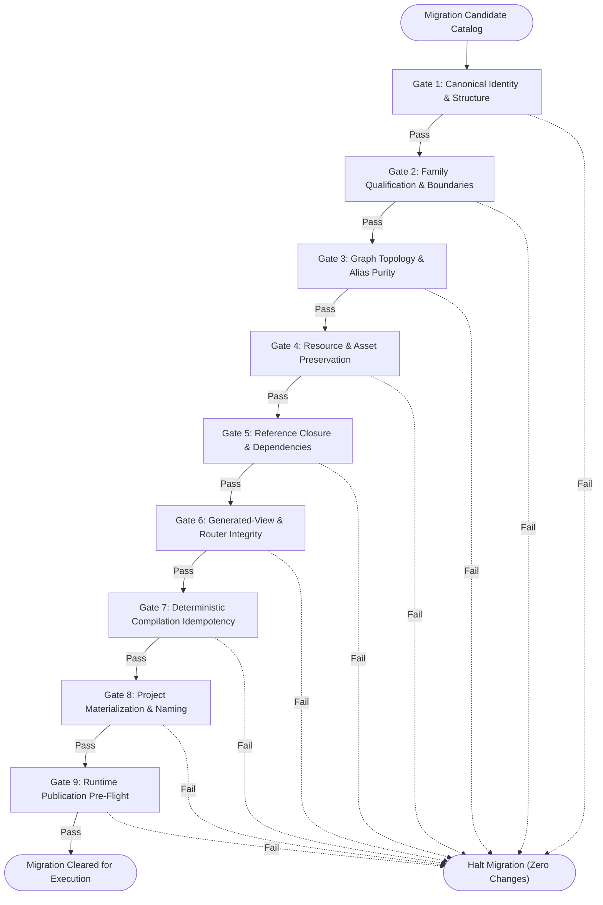

# ADR-005: Architecture Validation and Migration Gates

- **Status**: Proposed
- **Date**: 2026-10-17
- **Work Order**: REV-131 (`584da843-51f6-472b-8dd5-4ead75e39d20`)
- **Author**: Architecture & Infrastructure Team
- **Preceding Decisions**:
  - [ADR-001: Path-Independent Canonical Identity Contract](ADR-001-path-independent-canonical-identity.md) (REV-127)
  - [ADR-002: Physical Ownership Model](ADR-002-physical-ownership-model.md) (REV-128)
  - [ADR-003: Platform Family Eligibility & Provider-Adapter Implementation Rules](ADR-003-family-eligibility-and-provider-adapters.md) (REV-129)
  - [ADR-004: Registry, Router, Alias, Dependency, and Semantic Group Contracts](ADR-004-registry-router-alias-dependency-contracts.md) (REV-130)

---

## 1. Executive Summary & Context

Under **REV-127** through **REV-130**, the skills library established a comprehensive semantic object model, hybrid physical layout, platform family qualification framework, and execution/discovery plane:
1. **REV-127** ([ADR-001](ADR-001-path-independent-canonical-identity.md)): Decoupled skill identity (`<scope>:<slug>`) from transient filesystem storage paths and physical categories.
2. **REV-128** ([ADR-002](ADR-002-physical-ownership-model.md)): Established a hybrid physical layout pairing functional domain trees (`library/<category>/<subcategory>/`) with Tier 1 platform hubs (`library/tools-and-platforms/<family-slug>/`), enforcing strict direction-neutral duplicate protection for unresolved candidates.
3. **REV-129** ([ADR-003](ADR-003-family-eligibility-and-provider-adapters.md)): Formulated the 4-Gate Family Qualification Framework, decoupling execution providers (CLI, MCP, REST, SDK, Prompt) from canonical identity and mandating pure protocol adapters.
4. **REV-130** ([ADR-004](ADR-004-registry-router-alias-dependency-contracts.md)): Standardized the machine-readable catalog registry (`skills-registry.json`), multi-view projections, single-hop alias resolution, transitive DAG dependency closure, collision-free project materialization, and deterministic compilation idempotency.

However, moving over 2,130 living skill packages from historical rebuild directories (`audit/rebuild-phase-1-12/`) and transitional layouts into this new architecture represents a major operational risk. Without formal, non-destructive migration gates, physical operations risk:
- **Historical Provenance Amnesia**: Losing traceability back to Phase 01–12 audit records, batch plans, and split allocations.
- **Silent Asset Loss**: Leaving behind executable scripts, reference assets, or documentation files during package relocation.
- **Graph and Alias Corruption**: Introducing circular dependencies ($A \to B \to A$), dangling references ($A \to \emptyset$), multi-hop alias chains, or primitive compositions.
- **Naming Collisions**: Producing overlapping flat runtime filenames when materializing skills with identical names from different scopes or subcategories.
- **Premature Adjudication**: Unintentionally altering or adjudicating direction-neutral candidates (e.g. the 15 GitHub duplicate pairs) before explicit semantic review.
- **Compilation Non-Determinism**: Emitting unstable output bytes across compilers or CI workers.

This Architectural Decision Record (**ADR-005**) establishes the **9 Formal Architecture Validation and Migration Gates**, the **Historical Provenance Mapping Architecture**, and the **Pre-Flight Non-Destructive Verification Engine** required before any physical migration or runtime publication may take place.

---

## 2. Invariants Catalog (Validation & Migration Context)

All migration gates enforce the complete set of architectural invariants established in ADR-001 through ADR-004:

| Invariant | Name | Formal Statement & Enforcement Rule |
| :--- | :--- | :--- |
| **INV-1** | **Strict DAG Acyclicity** | The directed graph $G = (V, E)$ formed by `depends_on`, `composed_of`, `extends`, and `adapts` must contain no directed cycles: $\forall v \in V, v \notin \text{Reachable}^+(v)$. |
| **INV-2** | **Single Canonical Owner** | Every skill package has exactly one canonical identity $u \in \text{URN}$. For all $u_1, u_2 \in V$, $u_1 = u_2 \iff \text{target}(u_1) = \text{target}(u_2)$. No two active packages share an identity. |
| **INV-3** | **Single-Hop Alias Purity** | Every alias edge $a \xrightarrow{\text{alias}} t$ must point directly to an active canonical capability or workflow. Alias chaining ($a_1 \to a_2 \to t$) and circular aliases ($a_1 \to a_2 \to a_1$) are strictly forbidden. |
| **INV-4** | **Shallow Overlay Specialization** | An overlay object $o \in V_{\text{overlay}}$ can only extend a capability or workflow ($e \in V_{\text{capability}} \cup V_{\text{workflow}}$). Overlays cannot extend overlays ($\text{depth}(o) \le 1$). |
| **INV-5** | **Leaf Primitive Purity** | Primitive objects $p \in V_{\text{primitive}}$ are reusable atomic units and cannot compose workflows or other composite objects: $\text{composed\_of}(p) = \emptyset$. |
| **INV-6** | **Path Independence** | Canonical identities must be structural URNs of the form `<scope>:<slug>` matching `^[a-z0-9-]+:[a-z0-9-]+$`. Canonical IDs must never contain path separators (`/`, `\`) or file extensions (`.md`, `.py`). |
| **INV-7** | **Universal Reference Closure** | For every reference edge $e = (u, v) \in E$, the target $v$ must exist in the authoritative catalog registry $V$: $v \in V$. No dead or dangling references are permitted. |
| **INV-8** | **Family Boundary Separation** | Tier 1 platform hubs require approved 4-gate qualification. Tier 2 families are logical virtual routers and do not physically relocate member packages. Unadjudicated duplicate candidates remain direction-neutral. |
| **INV-9** | **Transitive Materialization Completeness** | Any materialized project bundle $\mathcal{B}(S)$ for skill set $S \subseteq V$ must be self-contained: $\forall s \in \mathcal{B}(S), \text{Dependencies}(s) \subseteq \mathcal{B}(S)$. |
| **INV-10** | **Deterministic Compilation Idempotency** | Given identical inputs $I$, two separate compilation executions must produce bit-for-bit identical outputs: $\text{Compile}(I) \equiv \text{Compile}(I)$. Volatile timestamps and system state are excluded or pinned. |

---

## 3. The 9 Formal Validation and Migration Gates

The migration engine evaluates packages through 9 sequential, deterministic gates. Every gate emits typed violations and an explicit status: `PASSED`, `WARNING`, `FAILED`, or `SKIPPED`.



### 3.1 Gate 1: Canonical Identity Uniqueness & Structure (INV-2, INV-6)
- **Objective**: Verify that every skill package possesses a globally unique, syntactically valid canonical identifier conforming to RFC 8141 URN principles.
- **Rules**:
  1. The canonical ID must strictly match regex `^[a-z0-9-]+:[a-z0-9-]+$`.
  2. The canonical ID must contain zero filesystem path characters (`/`, `\`, `.`).
  3. No two active catalog entries may share the same canonical ID.
  4. The canonical ID must cleanly parse into its RFC 8141 representation: `urn:skill:<scope>:<slug>`.
- **Failure Mode**: Any duplicate ID or structural syntax error halts the pipeline immediately (`FAILED`).

### 3.2 Gate 2: Family Qualification & Boundary Adherence (INV-8)
- **Objective**: Enforce the REV-128 physical ownership layout and REV-129 platform family governance by directly executing independent, census-backed `FamilyCandidateEvaluator` qualification validation.
- **Rules**:
  1. **Tier 1 Physical Hubs**: Platform families (e.g. `github`, `webflow`, `figma`) must satisfy all 4 qualification gates with verified evidence:
     - Gate 1: Official public tool surface cohesion (CLI, MCP, REST API, SDK).
     - Gate 2: Shared platform configuration/credentials/primitives.
     - Gate 3: Critical mass ($\ge 3$ distinct capabilities across $\ge 2$ functional categories, OR $\ge 5$ distinct, tightly coupled operations in 1 complex functional domain; $\ge 5$ capabilities for internal meta-families).
     - Gate 4: Coordinated release and version lifecycle.
  2. **Authoritative Census Cross-Examination**: Gate 2 does not trust declared tier strings or static lists; it invokes `FamilyCandidateEvaluator.evaluate_from_ledger(family_slug, census=census_inst)` against the authoritative semantic role census (`audit/taxonomy-census/semantic-role-census.json`). If evaluation raises an error, returns `PENDING_ADJUDICATION` (e.g. `notebooklm`), or does not establish `TIER_1_PLATFORM_HUB`, Gate 2 fails closed (`UNQUALIFIED_FAMILY_PHYSICAL_HUB`).
  3. **Physical Boundary Hold**: Only families that have formally qualified for Tier 1 via `FamilyCandidateEvaluator` may establish physical hubs in `library/tools-and-platforms/<family-slug>/`. Any skill placed in a platform hub must declare membership in that approved Tier 1 family.
  4. **Tier 2 Logical Families & Unadjudicated Candidates**: Logical cross-cutting groupings (e.g. `supabase`, `browser-automation`) and candidates pending adjudication (e.g. `notebooklm`) remain purely virtual routers anchored in functional domain directories (`library/<category>/<subcategory>/`) and are strictly prohibited from creating physical directories under `tools-and-platforms/`.
  5. **Direction-Neutral Hold & Ledger-Backed Duplicate Protection**: Candidate duplicate pairs (such as the 15 GitHub duplicate pairs) are identified by matching against `DuplicateCandidateRegistry.CANDIDATE_HYPOTHESES` (matching candidate canonical IDs, leaf names, legacy paths, platform paths, and tags). An untagged, renamed, or legacy candidate pair cannot bypass protection. Converting an unadjudicated candidate into an alias without documented adjudication is rejected (`UNADJUDICATED_DUPLICATE_ALIAS`), regardless of lifecycle status (`active`, `deprecated`, or otherwise).
- **Failure Mode**: Placement of skills in unqualified platform directories, unevidenced Tier 1 qualification claims, or premature duplicate alias conversion halts the migration (`FAILED`).

### 3.3 Gate 3: Graph Topology, Acyclicity & Alias Purity (INV-1, INV-3, INV-4, INV-5)
- **Objective**: Guarantee that the catalog relationship graph is a valid Directed Acyclic Graph (DAG) with strict structural bounds on aliases, overlays, and primitives.
- **Rules**:
  1. **Acyclicity (INV-1)**: Tarjan's or topological sort cycle detection across all directed edges (`depends_on`, `composed_of`, `extends`, `adapts`). Any cycle $v \to \dots \to v$ is fatal.
  2. **Single-Hop Alias Purity (INV-3)**: If $a$ is an alias pointing to $t$, $t$ must be a canonical capability or workflow. $t$ cannot itself be an alias (no chaining), and $t \ne a$ (no self-loops).
  3. **Overlay Specialization (INV-4)**: Overlays may only specialize base capabilities or workflows. Chained overlays ($o_1 \xrightarrow{\text{extends}} o_2$) are prohibited.
  4. **Primitive Composition Prohibition (INV-5)**: Primitives are leaf nodes and must declare empty `composed_of: []`.
- **Failure Mode**: Cyclic dependencies, alias chains, invalid overlay targets, or composite primitives fail Gate 3 (`FAILED`).

### 3.4 Gate 4: Resource & Asset Preservation (Zero Data Loss)
- **Objective**: Ensure that 100% of physical assets, executables, scripts, templates, and documentation are accounted for, independently verified against real disk files, and protected from loss, tampering, or truncation during migration.
- **Rules**:
  1. **Static Package Inventory Audit**: Every physical skill package directory must contain a valid, non-empty `SKILL.md` (`size > 0`). All auxiliary resources (under `scripts/`, `references/`, `assets/`, `schemas/`) are checked for 0-byte truncation (`TRUNCATED_ASSET_FILE`). Skills undergoing planned moves in migration authorization mode are audited against their planned migration evidence to avoid false existence errors before physical moves.
  2. **Migration Preflight Authorization Boundary**: Gate 4 strictly distinguishes a static directory audit from migration preflight authorization. When a physical migration is planned (`is_migration_authorization=True`, `planned_moves`, or `migration_manifest`), complete source and destination package manifests (`SkillPackageManifest`) are mandatory for every planned move:
     - Missing source manifest fails closed with `MISSING_SOURCE_MANIFEST`.
     - Missing destination manifest fails closed with `MISSING_DESTINATION_MANIFEST`.
     - Absence of planned moves in authorization mode fails closed with `MISSING_MIGRATION_MANIFEST`.
     - Gate 4 will **never** silently fall back to directory existence checks when authorizing physical moves.
  3. **Three-Tier Manifest & File Evidence Verification Model**:
     - **Tier 1 (Manifest Presence & Alignment)**: Complete manifests must be supplied and verify that manifest `skill_id` matches the planned move (`MANIFEST_IDENTITY_MISMATCH`) and canonical paths align (`MANIFEST_PATH_MISMATCH`). Two internally consistent manifests cannot certify themselves.
     - **Tier 2 (Fresh On-Disk Generation & Cross-Examination)**: Fresh recursive file inventories and SHA-256 digests are independently generated directly from actual on-disk files. The independently computed inventories are cross-examined against the supplied manifests:
       - Any checksum divergence or file size mismatch fails with `FABRICATED_MANIFEST_CHECKSUM` (preventing forged or stale manifests).
       - Any file present on disk but omitted from the manifest fails with `MANIFEST_OMITTED_FILE`.
       - Any file listed in the manifest but absent from disk fails with `MANIFEST_PHANTOM_FILE`.
     - **Tier 3 (Source-to-Destination Preservation)**: Deterministic 1-to-1 comparison between source disk inventory and destination disk inventory:
       $$\text{SHA-256}(\text{Asset}_{\text{source}}) \equiv \text{SHA-256}(\text{Asset}_{\text{dest}})$$
       Any file missing in the destination fails with `MISSING_SUPPORTING_ASSET`, any altered content fails with `RESOURCE_CHECKSUM_MISMATCH`, and any unexpected unmapped asset in the destination fails with `UNEXPECTED_DESTINATION_FILE`.
  4. **Non-Destructive Staging Preflight Pattern**:
     - Preflight validation is strictly non-destructive. If a planned destination does not yet exist in the live catalog, the candidate package must be staged in an explicitly designated, isolated staging directory (`staged_dir`, `staging_directories`, or under `staging_root`).
     - If neither the live destination directory nor an authentic staged package exists on disk, Gate 4 fails closed with `MISSING_DESTINATION_EVIDENCE`.
     - Preflight evaluation never creates, moves, renames, copies, or deletes live catalog files.
  5. **Canonical Path Containment & Security Invariants**:
     - All source, destination, and staging paths must resolve strictly within the repository root or authorized staging roots.
     - Traversal sequences (`..`), unauthorized absolute filesystem paths, or symlinks pointing outside allowed boundaries are rejected immediately (`PATH_TRAVERSAL_DETECTED`).
- **Failure Mode**: Missing manifests, fabricated or stale checksums, omitted or phantom files, path traversal escapes, missing destination evidence, truncated files, or checksum divergences fail Gate 4 (`FAILED`).

### 3.5 Gate 5: Reference Closure & Dependency Completeness (INV-7)
- **Objective**: Ensure that all referenced identifiers across all relationship types resolve to active entries in the authoritative catalog registry.
- **Rules**:
  1. Every ID listed in `depends_on` must exist in the catalog.
  2. Every ID listed in `composed_of` must exist in the catalog.
  3. Every ID listed in `extends` must exist in the catalog.
  4. Every ID listed in `adapts` must exist in the catalog.
  5. Every ID listed in `aliased_to` must exist in the catalog.
  6. Workflow steps must reference existing capabilities, primitives, or workflows.
- **Failure Mode**: Any dangling reference ($u \to \emptyset$) fails Gate 5 (`FAILED`).

### 3.6 Gate 6: Generated-View Reconciliation & Router Integrity
- **Objective**: Validate that multi-view projections, inverted search indices, and router markdown documents maintain full coverage, proper formatting, and relative path links.
- **Rules**:
  1. **Projection Coverage**: Functional, Family, Semantic Group, and Provider views must together partition or cover 100% of active catalog entries.
  2. **Relative Link Purity**: All router links must be strictly relative paths (e.g. `../developer-tools/git/SKILL.md` or `create-pull-request/SKILL.md`). Absolute filesystem links (`/Users/...`, `C:\...`) and repository root links (`file:///...`) are strictly prohibited.
  3. **Provider Badging**: Platform family routers must display badge metadata indicating supported execution provider transports (`CLI`, `MCP`, `REST`, `SDK`, `Prompt`).
  4. **Search Index Reconciled**: The inverted search index must index 100% of active skills by name, tokens, keywords, and tags.
- **Failure Mode**: Missing view coverage, broken relative links, or forbidden absolute paths fails Gate 6 (`FAILED`).

### 3.7 Gate 7: Deterministic Compilation & Idempotency (INV-10)
- **Objective**: Guarantee that catalog compilation is perfectly idempotent and byte-for-byte reproducible across different compiler runs and platforms.
- **Rules**:
  1. Two independent compiler executions over the same source catalog must produce bit-for-bit identical output for `skills-registry.json`, `search-index.json`, and all family router markdown files:
     $$\text{SHA-256}(\text{Compilation}_1) \equiv \text{SHA-256}(\text{Compilation}_2)$$
  2. Dynamic runtime timestamps (`datetime.now()`) are prohibited in production compiled outputs unless an explicit pinned build timestamp is injected.
  3. All dictionary keys, sets, and lists in compiled artifacts must follow stable canonical sorting orders.
- **Failure Mode**: Any hash mismatch or non-deterministic serialization between consecutive compilations fails Gate 7 (`FAILED`).

### 3.8 Gate 8: Project Materialization Completeness & Collision-Free Runtime Naming (INV-9)
- **Objective**: Ensure that materializing any subset of skills into a standalone project bundle is self-contained and produces guaranteed unique runtime directory names.
- **Rules**:
  1. **Transitive Dependency Closure (INV-9)**: When a set of skills $S$ is selected for materialization, all transitive prerequisites $\bigcup_{s \in S} \text{Closure}(s)$ must be included in the bundle.
  2. **Collision-Free Runtime Naming Ladder**: When flattening hierarchical packages into runtime directories (e.g. `.agent/skills/<runtime-name>`), name collisions must be resolved through an unambiguous 6-stage candidate ladder:
     - Stage 1: Bare name (`<name>`)
     - Stage 2: Scope prefix (`<scope>-<name>`)
     - Stage 3: Category prefix (`<category>-<name>`)
     - Stage 4: Subcategory prefix (`<subcategory>-<name>`)
     - Stage 5: Fully qualified path slug (`<category>-<subcategory>-<name>`)
     - Stage 6: Deterministic canonical hash fallback (`<name>-<sha256[:8]>`)
  3. **Zero Collisions**: The final set of runtime names in the bundle must be strictly bijective: $|Names| = |Skills|$.
- **Failure Mode**: Missing transitive dependencies or runtime name collisions fail Gate 8 (`FAILED`).

### 3.9 Gate 9: Runtime Publication Pre-Flight & Target Compatibility
- **Objective**: Perform a safe, dry-run simulation of publication steps, verifying target environment compatibility and ensuring zero unexpected file modifications.
- **Rules**:
  1. **Clean Protected Assets**: The working tree under protected paths (`library/**`, `audit/taxonomy-census/**`) must remain completely clean and unmutated during pre-flight evaluation.
  2. **Target Path Writable & Accessible**: Staging directories and publication targets must be validated for write permissions and path length limits without modifying live catalog files.
  3. **Rollback Manifest Ready**: A dry-run publication generates a deterministic rollback manifest recording every simulated file creation, symlink, or move before physical execution.
- **Failure Mode**: Uncommitted working tree drift in protected directories or missing rollback safeguards fails Gate 9 (`FAILED`).

---

## 4. Historical Phase 01–12 Provenance Mapping Architecture

A critical amendment of **REV-131** is the formal reconciliation of all historical rebuild provenance records to the new canonical identity model.

### 4.1 Immutable Historical Records
The repository contains 2,103 historical rebuild records across:
- `audit/rebuild-phase-1-12/phase08-canonical-registry.csv`
- `audit/rebuild-phase-1-12/phase08-batch-plan.csv`
- `audit/rebuild-phase-1-12/split-allocations.csv`

These records reference historical origin paths formatted as:
`task-folder/agents/skills-rebuild/<category>/<subcategory>/<name>`

In accordance with REV-131 directives:
> **Historical origin paths remain immutable audit evidence.** Migration validation maps every historical Phase 01–12 provenance record to the new stable canonical identity model before physical moves. Traceability is preserved without rewriting history.

### 4.2 Provenance Mapping Data Model

Every historical record is mapped into a typed `HistoricalProvenanceRecord`:

```json
{
  "historical_id": "phase08:development:git:commit",
  "historical_path": "task-folder/agents/skills-rebuild/development/git/commit",
  "batch_id": "batch-04",
  "phase": "phase-08",
  "canonical_id": "development:commit",
  "urn": "urn:skill:development:commit",
  "current_physical_path": "library/development/git/commit",
  "provenance_type": "HISTORICAL_REBUILD_PHASE08",
  "reconciled": true
}
```

### 4.3 Census & Platform Family Candidates Reconciliation
The living semantic census (`audit/taxonomy-census/semantic-role-census.json`) contains 2,133 active skill packages:
- **2,102 packages** match historical Phase 08 entries directly via path normalization (`task-folder/agents/skills-rebuild/...` $\to$ `library/...`).
- **1 package** (`design-md_v1` $\to$ `design-md`) is reconciled via documented historical name aliasing.
- **30 platform family candidates** (15 `github-operations` and 15 `skills-create-manage-update` platform family candidates evaluated in REV-126/150) are tracked as first-class platform provenance records (`PLATFORM_CENSUS_ADDITION`), preserving full census accountability.
- **Result**: **100% of living skill packages and 100% of historical rebuild records are reconciled into stable canonical identities with zero unmapped assets.**

---

## 5. Non-Destructive Pre-Flight & Rollback Architecture

### 5.1 Dry-Run Simulation Contract
Migration validation is strictly read-only and non-destructive:
1. `MigrationGateEvaluator` reads catalog entries, graph relationships, and census files from disk or in-memory objects.
2. Gates 1 through 8 evaluate structural, topological, and compilation invariants.
3. Gate 9 verifies that protected paths are untouched and simulates publication targets in isolated temporary scratch areas.
4. **No physical moves, file deletions, or git commits are executed during validation.**

### 5.2 Atomic Rollback Semantics
When physical migration execution is subsequently initiated (in follow-on work orders):
- The migration runner must generate a forward journal ($\mathcal{J}_{\text{forward}}$) and a corresponding reverse rollback journal ($\mathcal{J}_{\text{rollback}}$).
- If any gate or step fails during execution, the reverse journal executes in reverse order, restoring original file paths and states.
- The working tree is verified against pre-migration git SHAs to ensure zero partial-state corruption.

---

## 6. Consequences & Migration Readiness

### 6.1 Positive Consequences
- **Zero-Breakage Guarantee**: Formal gates prevent runtime failures, circular dependencies, and asset loss before any physical file is moved.
- **Complete Historical Provenance**: 100% of Phase 01–12 rebuild data is linked to modern canonical identities without altering historical audit trails.
- **Direction-Neutral Protection**: Prevents premature duplicate adjudication, strictly protecting REV-128 and REV-130 decisions.
- **Deterministic Deployment**: Gate 7 guarantees that CI/CD, local developers, and automated agents generate byte-for-byte identical catalog artifacts.

### 6.2 Operational Constraints
- All 9 gates must report `PASSED` (or acceptable `WARNING` for pending non-blocking reviews) before any migration command is authorized.
- No physical file moves under `library/**` or modifications to `audit/taxonomy-census/**` may occur within REV-131.
